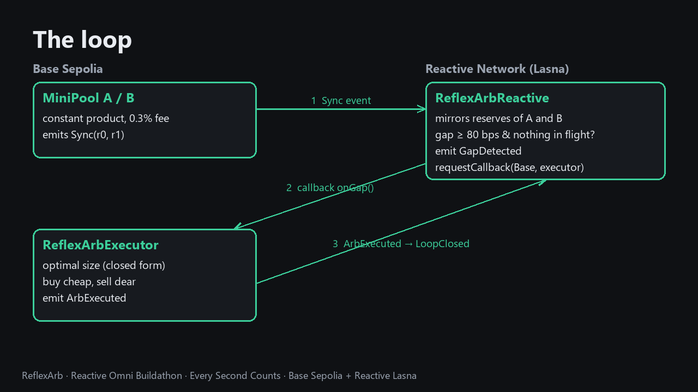
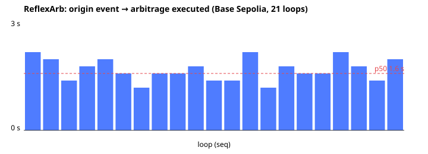

# ReflexArb — reactive cross-pool arbitrage on Reactive Omni

**Track:** Every Second Counts (time-sensitive DeFi on Base Sepolia).

**Demo video (64 s):** [`docs/video/reflexarb-demo.mp4`](docs/video/reflexarb-demo.mp4) · **Median loop: 1.6 s** from the origin swap to the executed arbitrage over 21 live loops.



Two constant-product pools on Base Sepolia quote the same pair. When a trade pushes one pool's price away from
the other, a **reactive contract on Reactive Network (Lasna)** sees the pools' `Sync` events, mirrors their
reserves, and — the moment the gap exceeds a threshold — asks Reactive to call an **executor on Base Sepolia**.
The executor computes the optimal size in closed form and closes the gap in one transaction. No bot, no server,
no keeper: the loop is event → reactive contract → callback, all on-chain.

```
 Base Sepolia (origin + destination)                     Reactive Network — Lasna
 ─────────────────────────────────────                   ──────────────────────────────
  trader swaps in MiniPool A ──► Sync(r0, r1) ─────────►  ReflexArbReactive.react()
                                                          · mirrors reserves of pools A and B
  MiniPool B ─────────────────► Sync(r0, r1) ─────────►  · gap = |pA − pB| / min(pA, pB)
                                                          · gap ≥ 80 bps and nothing in flight?
                                                          · emit GapDetected(seq, originBlock, …)
  ReflexArbExecutor.onGap() ◄── callback via proxy ◄────  requestCallbackV_1_0(Base, executor, onGap)
  · read both pools, optimal size (closed form)
  · buy where cheap, sell where dear, keep profit
  · emit ArbExecuted(seq, originBlock, execBlock, …) ──►  react(): LoopClosed(seq, …), unlock
```

## Why it needs Reactive

The gap lives for as long as nobody closes it. Polling bots pay for latency with infrastructure; a reactive
contract is triggered by the event itself. On Omni (~1 s blocks, instant finality) the whole loop fits inside a
couple of seconds, which is what the latency numbers below measure.

## Contracts

| Contract | Chain | Address |
|---|---|---|
| `ReflexArbReactive` | Reactive Lasna (5318007) | `0xc444887fb28a08d78509a63260F9662b39EDbC68` |
| `ReflexArbExecutor` | Base Sepolia (84532) | `0xA01eA2169A6ce6069DdE73c61A4C7aB3A263C81E` |
| `MiniPool` A | Base Sepolia | `0xc444887fb28a08d78509a63260F9662b39EDbC68` |
| `MiniPool` B | Base Sepolia | `0xa719970c2d742feeB56B089b830E3eFA126B7b12` |
| `MiniToken` RX0 (token0) | Base Sepolia | `0x1Dc6e2eE4AaA58f6F52A9CD28bC78e506A5EaFeA` |
| `MiniToken` RXUSD (token1) | Base Sepolia | `0xeE57F8c15aa81c83C5bE1eF2b157b304b9e3b815` |
| Callback proxy (Reactive) | Base Sepolia | `0x476F44b11F5C942c58f4c8E3d0300E5710743585` |

The reactive contract and pool A share an address only because the same deployer used the same nonce on two
different chains.

## How the reactive contract works

- **Subscriptions:** `Sync(uint112,uint112)` of both pools (the Uniswap V2 event signature, so any V2 pair could be
  watched the same way), plus `ArbExecuted` / `ArbSkipped` of the executor.
- **Trigger:** gap ≥ `thresholdBps` (80). The threshold must sit above the two-pool fee band: with 0.3 % fees an
  optimal arbitrage leaves a residual gap of ~2 × fee ≈ 59–60 bps, and inside that band no arbitrage pays.
- **One loop in flight:** the arbitrage itself emits two `Sync` events; the first would otherwise look like a fresh
  gap against the not-yet-updated second pool. The flag is cleared by the executor's own event (`LoopClosed`) or
  by a timeout.
- **Timers in seconds, not blocks:** Base Sepolia produces a block every 200 ms, so cooldown and timeout use
  `block.timestamp`. On Omni `react()` runs inside an ordinary Lasna block (~1 s), so that timestamp is wall-clock
  time (verified on chain: the reactive transaction is a regular Lasna transaction from the validator to the system
  contract `0x8888…8888`).
- **Callback:** `requestCallbackV_1_0` to the executor with `onGap(address, seq, originBlock, gapBps)`; Reactive
  overwrites the first argument with the reactive contract's address, and the executor accepts calls only from the
  callback proxy *and* that reactive contract.

## How the executor sizes the trade

For two constant-product pools with fee `g`, buying token0 in the cheap pool and selling it in the dear one, the
profit-maximising token1 input has a closed form:

```
Ea = rIn1·rOut0 / (rOut0 + g·rIn0),   Eb = g·rIn0·rOut1 / (rOut0 + g·rIn0),   x* = (√(Ea·Eb·g) − Ea) / g
```

`optimalIn` implements it in integer math (Babylonian square root); a test checks it beats its neighbours. If the
gap has already been closed by someone else, the callback reverts with `unprofitable` and loses only gas.

## Latency

Measured on 2026-11-11 with `bench/latency.ts`: each loop pushes pool A's price with one swap (alternating
directions, gap 138–264 bps), then waits for the executor. The report (`bench/report.ts`) is rebuilt from chain
events only, so it does not depend on the benchmark's own clock.

| Metric (21 executed loops) | Value |
|---|---|
| Origin swap → arbitrage executed, Base blocks | min 6 · **p50 8** · p95 11 · max 11 |
| Same, seconds (Base Sepolia block = 0.2 s, measured on chain) | min 1.2 s · **p50 1.6 s** · p95 2.2 s · mean 1.7 s |
| Origin block → `GapDetected` on Lasna | same second (timestamps differ by 0 to −1 s across the two chains) |
| `GapDetected` → `LoopClosed` on Lasna (callback executed and its event seen) | 1–3 s |
| Gap after the arbitrage | 59–60 bps every time (the two-fee band) |
| Profit kept by the executor | 11.28 RXUSD in total |



Every loop with transaction links (Basescan for the executor, Reactscan for the reactive side):
[`bench/results/loops.md`](bench/results/loops.md); raw data: [`bench/results/summary.json`](bench/results/summary.json).
Loops 1–2 show `skipped`: the previous deployment was still subscribed to the same pools and closed the gap first
(see the notes at the end).

A sample loop, end to end (seq 9):
- origin swap on Base Sepolia — block 57215901, [0xbaac9d07…](https://sepolia.basescan.org/tx/0xbaac9d0798eb7665fa43c60499669221dd348b18ff34a1a0952074c4c31cf78d);
- `GapDetected` on Lasna — [0x44148223…](https://lasna.reactscan.net/tx/0x44148223c977fc05e65f9e6ee740f787e6ef9ddec3aa4257eae0371749602bc5);
- callback `ArbExecuted` on Base Sepolia — block 57215907, 6 blocks (1.2 s) later, gap 138 → 60 bps, [0x162d627c…](https://sepolia.basescan.org/tx/0x162d627cd57c92ff61c0ec9161527bf74267b293a332694c78266cad592415b3).

## Run it

```bash
forge install foundry-rs/forge-std Reactive-Network/reactive-lib-omni@v0.1.0   # dependencies (lib/ is not committed)
forge test                                   # 16 tests: math, triggers, in-flight lock, timeouts in seconds, access control
bash script/deploy.sh                        # full deploy: tokens, pools, executor, reactive contract
bash script/redeploy-loop.sh                 # new reactive contract + executor, keep tokens and pools
cd bench && npm install && npx tsx latency.ts 20   # shock / arbitrage loops
npx tsx report.ts                            # latency report from chain events
```

Environment: `PK`, `ME`, `BASE_SEPOLIA_RPC`, `LASNA_RPC`. Gas: Sepolia ETH bridged to Base Sepolia
(`L1StandardBridge.depositETH`) and lREACT from the Reactive faucet contract on Sepolia.

## Notes from building it

- After deploying, the reactive contract knows nothing about reserves that were set before its subscriptions
  existed; `deploy.sh` pokes both pools with `addLiquidity(0, 0)` so a fresh `Sync` arrives.
- A reactive contract that runs out of lREACT accumulates debt and stops receiving events until `coverDebt()`;
  measured cost on Lasna was about 0.05 lREACT per full loop (shock + arbitrage = four reactive transactions).
- Replacing a deployment: an old reactive contract keeps reacting to the same pools. Point it at `address(0)`
  with `configure` (and withdraw the old executor's inventory), or two executors will race.

## License

MIT
